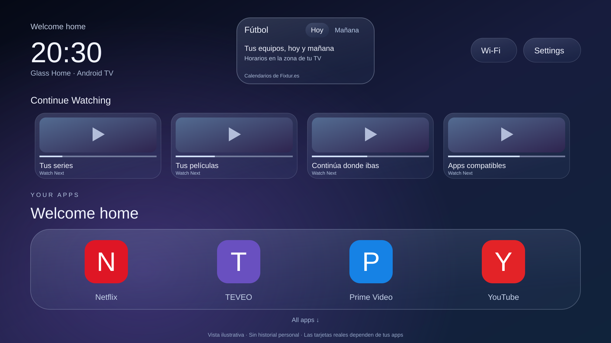

# Glass Home

Un launcher para **Android TV y Google TV** con fondo azul/violeta, dock flotante, efecto de cristal, Continue Watching y un panel compacto de fútbol para hoy y mañana.

**[Descargar APK 1.3.2](downloads/GlassHome-1.3.2.apk?raw=true)** · [Instalación y restauración](docs/INSTALACION.md) · [Compilar y personalizar](docs/DESARROLLO.md)



La imagen es una ilustración del diseño. Las tarjetas, aplicaciones y partidos reales dependen de lo que tengas instalado y de los calendarios disponibles.

## Qué incluye

- Fondo estático azul/violeta con reflejos y paneles translúcidos dibujados con degradados; sin desenfoque continuo ni vídeo de fondo.
- Dock inicial: Netflix → TEVEO → Prime Video → YouTube, con los iconos de tus aplicaciones instaladas.
- Navegación por flechas, cuadrícula de apps, reloj y acceso a Wi-Fi y Ajustes.
- Continue Watching mediante **Android TV Watch Next**: títulos, progreso y enlaces de reanudación publicados por las apps compatibles.
- Fútbol en una tarjeta de 216 dp centrada entre el reloj y Wi-Fi/Ajustes, con pestañas Hoy/Mañana y horarios según la zona de la TV.
- Calendarios iniciales: Real Madrid, Bayern Múnich, Barcelona, Atlético Nacional y selección de Colombia.

## Compatibilidad

Requiere Android TV/Google TV con Android 8.0 o superior. Probado físicamente en un Xiaomi MiTV-AFMU0 con Android 14, a 1920 × 1080. Otros modelos, resoluciones y versiones de firmware necesitan sus propias pruebas. **No es una aplicación para Samsung Tizen ni LG webOS.**

Las apps de streaming se instalan por separado; Glass Home no incluye contenido, suscripciones ni transmisiones. Netflix y Prime Video publicaron tarjetas utilizables en el equipo probado, pero esa disponibilidad puede cambiar entre versiones, cuentas y dispositivos.

**TEVEO debe publicar Watch Next desde su propia app.** Instalar este launcher no añade esa función a TEVEO. Este repositorio no contiene código, APK ni modificaciones de TEVEO. Si una actualización de cualquier app deja de publicar tarjetas, el launcher no puede reconstruir su historial privado.

## Instalación rápida con ADB

1. Descarga el [APK](downloads/GlassHome-1.3.2.apk?raw=true) y [Android Platform Tools](https://developer.android.com/tools/releases/platform-tools).
2. Activa la depuración en la TV y utiliza la dirección **IP:puerto que muestre ahora**. En Android con emparejamiento inalámbrico, empareja primero con el puerto y código de esa pantalla.
3. Instala y abre el launcher:

```sh
adb connect IP:PUERTO
adb -s IP:PUERTO install -r GlassHome-1.3.2.apk
adb -s IP:PUERTO shell pm grant local.glasshome android.permission.READ_TV_LISTINGS
adb -s IP:PUERTO shell am start -n local.glasshome/.MainActivity
```

En Windows también puedes usar [scripts/install.ps1](scripts/install.ps1), que guarda el componente HOME anterior y una copia del APK de Glass Home si ya estaba instalado. **No deshabilita apps del sistema ni cambia DNS.**

Comprueba la navegación antes de seleccionar Glass Home como inicio predeterminado. Consulta [la guía completa](docs/INSTALACION.md) para hacerlo y para volver atrás. Un firmware puede impedir cambiar HOME; no ejecutes listas de deshabilitación tomadas de otro dispositivo.

## Control remoto

| Desde | Acción |
|---|---|
| Dock | ←/→ cambia de app; ↑ entra en Continue Watching; ↓ abre la cuadrícula |
| Continue Watching | ←/→ recorre títulos; ↑ va a Fútbol; ↓ vuelve al dock |
| Fútbol | ←/→ cambia Hoy/Mañana; → desde Mañana pasa a Wi-Fi |
| Hoy/Mañana | ↓ entra en los partidos; si no hay, vuelve a Continue Watching |
| Partido | OK abre su detalle; ↓ desde el último vuelve a Continue Watching |
| Wi-Fi/Ajustes | ←/→ cambia de control; ← desde Wi-Fi regresa a Fútbol |
| Cualquier sección del launcher | Atrás regresa al dock |

## Datos y privacidad

Continue Watching lee los listados compartidos de Android TV con `READ_TV_LISTINGS`. No entra en bases privadas de otras apps ni solicita sus contraseñas. Los enlaces de reanudación se limitan a la aplicación que publicó cada tarjeta. Las imágenes de esos listados pueden solicitarse a sus proveedores mediante HTTPS.

El panel de fútbol utiliza las [suscripciones iCalendar gratuitas de Fixtur.es](https://fixtur.es/es/team/real-madrid), no extrae datos de FotMob. Mantiene una caché privada, respeta una ventana de seis horas entre actualizaciones de cada calendario y espera al menos 15 minutos después de un fallo. Solo consulta al volver al launcher o al cambiar de día mientras está visible. No incluye marcadores en directo; cobertura y horarios dependen de la fuente.

No hay analítica propia, servidor propio ni servicio permanente en segundo plano. La app guarda localmente la última app seleccionada y la caché de calendarios. Android puede incluir esos datos en sus mecanismos de copia de seguridad. Los proveedores externos reciben las solicitudes de red necesarias para imágenes y calendarios.

## Código y validación

Java 17, Android SDK 35, Gradle wrapper y AndroidX RecyclerView. [Cómo compilar](docs/DESARROLLO.md).

La interfaz compacta se instaló y revisó en el Xiaomi indicado. Se probaron Hoy/Mañana, detalles de partidos, navegación con D-pad, Wi-Fi/Ajustes y regreso a HOME. El lector iCalendar pasó 24 comprobaciones, incluidas pruebas con cinco calendarios reales. Las pruebas reproducibles sin red están en `checks/FootballFixturesCheck.java`.

Los builds de GitHub Actions son compilaciones de depuración para comprobar el código; sus firmas pueden variar. Para instalar o actualizar la distribución oficial utiliza el APK de `downloads/` y verifica [SHA256SUMS](downloads/SHA256SUMS).

## Licencias y aportes

Código propio bajo [MIT](LICENSE). La fuente Outfit conserva su [SIL Open Font License](Outfit-OFL.txt). Consulta [THIRD_PARTY_NOTICES.md](THIRD_PARTY_NOTICES.md) para dependencias, calendarios y marcas de terceros.

Puedes abrir un issue con tu modelo, versión Android y una descripción del problema. No publiques contraseñas, códigos de emparejamiento, direcciones de proveedores ni capturas con historial personal.
