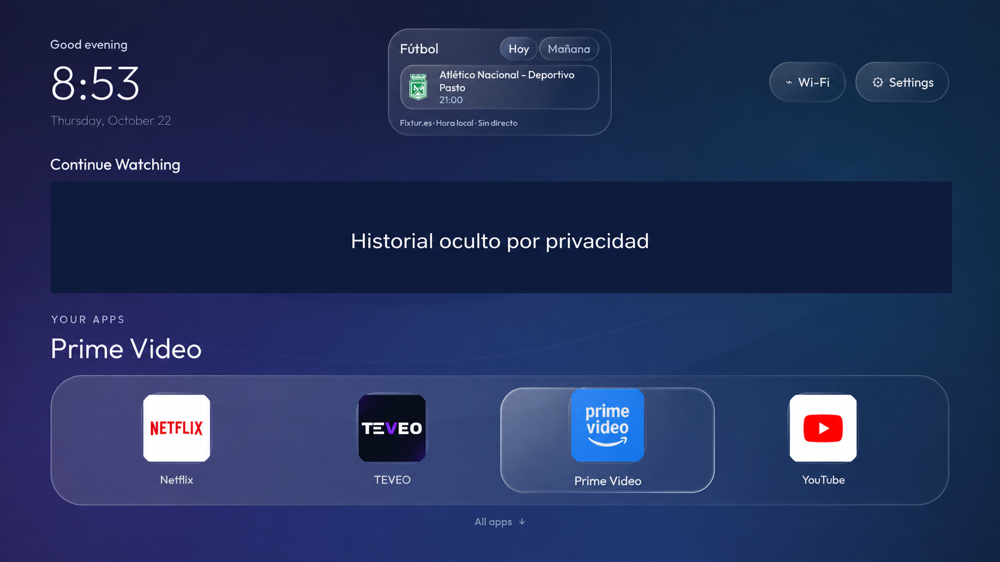
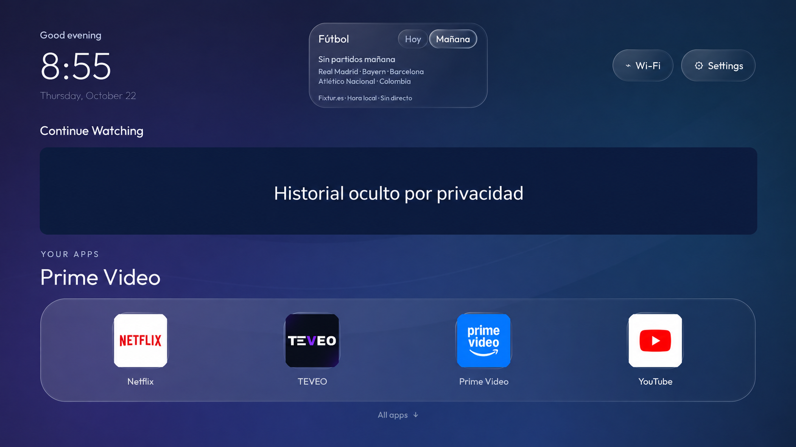

# Capturas del launcher en la TV

Estas vistas proceden de capturas realizadas en el Xiaomi MiTV-AFMU0 durante la comprobación de la interfaz compacta 1.3.2. Muestran el fondo azul/violeta, el dock de cuatro apps y el fútbol centrado entre el reloj y Wi-Fi/Ajustes.

**Privacidad:** se utilizó la herramienta de edición de imágenes con IA para cubrir toda la fila de tarjetas de Continuar viendo, incluidos títulos, imágenes y progreso. Estas son versiones editadas de las capturas, no archivos originales sin modificar; la edición puede introducir pequeñas diferencias visuales. El recuadro «Historial oculto por privacidad» es una redacción editorial y no aparece en el launcher instalado. Los originales con historial no se incluyen en el repositorio.

## Inicio y fútbol de hoy

El panel superior mantiene su tamaño compacto. El dock muestra Netflix → TEVEO → Prime Video → YouTube, con Prime Video enfocado.

## Fútbol de mañana

Esta captura muestra el estado sin partidos para mañana que devolvía el calendario al tomarla. Es una vista histórica; no describe los encuentros de la fecha actual.

## Cómo interpretar las imágenes

Las aplicaciones, horarios y tarjetas dependen del dispositivo y de los proveedores. Continuar viendo requiere que cada app publique Android TV Watch Next; instalar el launcher no añade esa integración a TEVEO. Los nombres, iconos y escudos pertenecen a sus titulares, según [los avisos de terceros](../THIRD_PARTY_NOTICES.md).

La instrucción de edición utilizada en ambas imágenes fue: cubrir con un rectángulo opaco toda la fila de tarjetas y el progreso, colocar «Historial oculto por privacidad» y conservar el resto de la interfaz, sin inventar títulos ni funciones.

[Descargar e instalar](INSTALACION.md) · [Prompt completo en español](PROMPT-INSTALACION-ES.md) · [Volver a la portada](../README.md)
