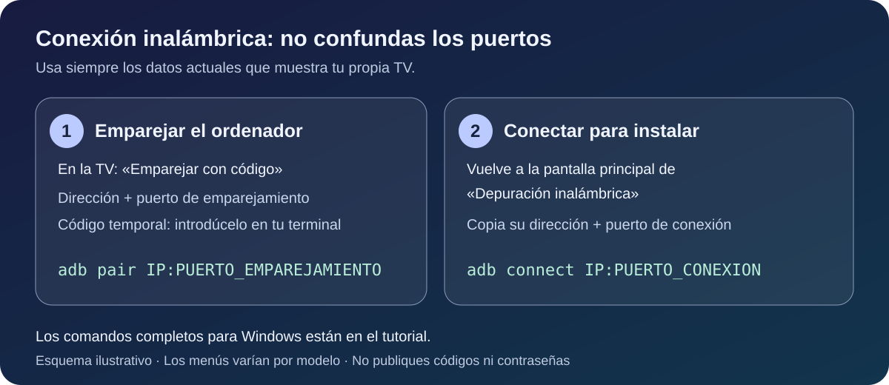
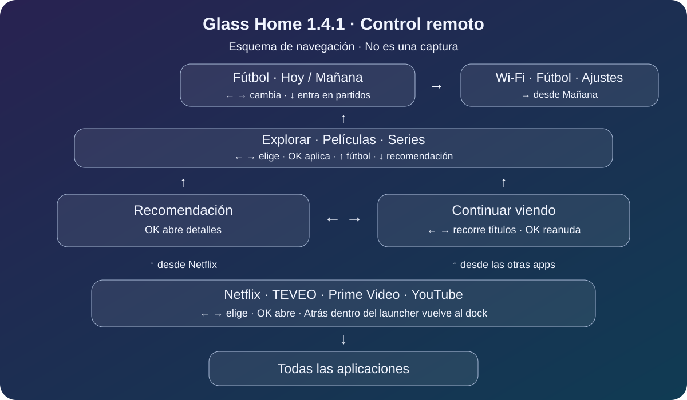
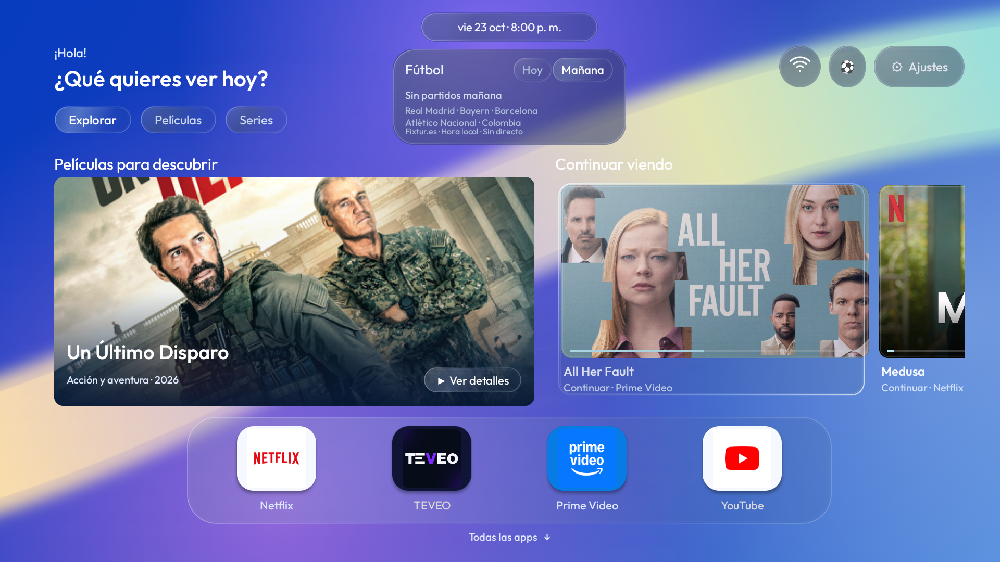
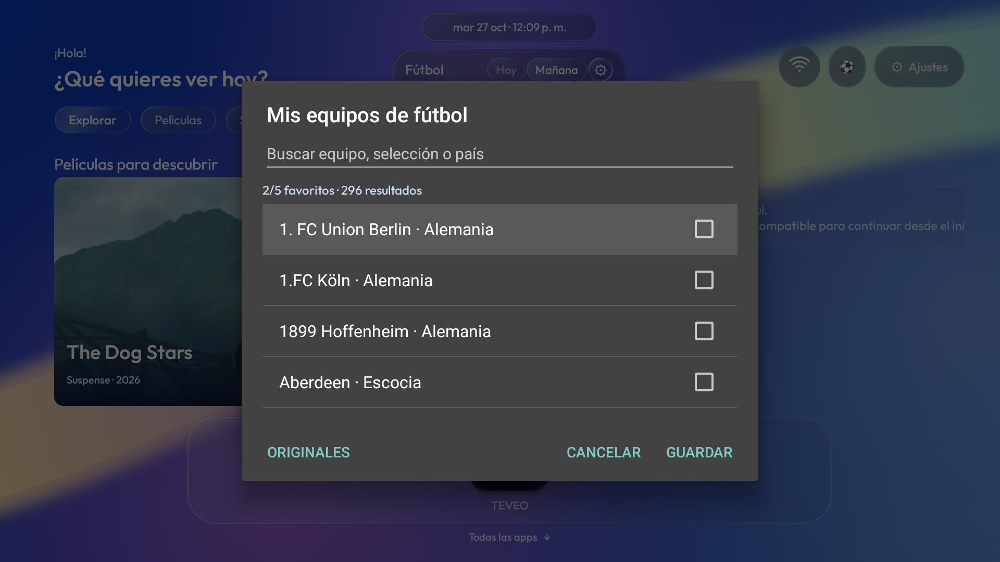

# Tutorial: instala y usa Glass Home en tu TV

Esta guía te acompaña desde la descarga hasta el primer inicio. No necesitas programar. Para el recorrido manual necesitas un ordenador Windows, acceso a Ajustes en la TV y poder copiar algunos comandos. También puedes pedir ayuda a un asistente con acceso a terminal.

**[Descargar el proyecto completo](https://github.com/soycaxte-lab/glass-home/archive/refs/heads/main.zip)** · [Solo el APK 1.6.0](../downloads/GlassHome-1.6.0.apk?raw=true) · [Copiar el prompt para tu asistente](PROMPT-INSTALACION-ES.md)

## 1. Mira el resultado y comprueba tu equipo


*Captura real del diseño 1.4.1, conservado en la versión 1.6.0, en el Xiaomi de referencia, sin edición. Continuar viendo se muestra con autorización del propietario.*

Glass Home sustituye la pantalla de inicio de **Android TV o Google TV con Android 8.0 o superior**. Incluye la recomendación grande a la izquierda, Continuar viendo a la derecha, el dock de iconos y el fútbol debajo de la fecha que ves aquí. Se probó en un Xiaomi MiTV-AFMU0 con Android 14; otros equipos y controles necesitan sus propias comprobaciones.

Si tu televisor utiliza **Samsung Tizen o LG webOS**, este APK no se instala directamente. Puedes usar un dispositivo Android TV/Google TV conectado por HDMI. Un Xiaomi TV Box conectado a un Samsung sí puede ejecutar el launcher en el box.

Ten preparados:

- El control remoto y acceso al menú Ajustes de tu dispositivo Android TV.
- La TV/box y el ordenador conectados a la misma red local de confianza. Las redes de invitados o el aislamiento entre dispositivos pueden impedir la conexión.
- Espacio para descargar el proyecto y las herramientas de Android.
- Tus apps de streaming instaladas por separado. Glass Home no incluye suscripciones, cuentas ni películas.

No hace falta root ni restablecer la TV. No borres datos ni desinstales el inicio de fábrica para seguir esta guía.

## 2. Elige cómo quieres instalarlo

| Camino | Qué hacer |
|---|---|
| Con un asistente | Abre el [prompt completo en español](PROMPT-INSTALACION-ES.md), copia todo el bloque y pégalo en tu asistente con acceso a archivos, terminal y red. Él prepara las herramientas y te pide los pasos físicos. |
| Manual en Windows | Continúa desde el paso 3. Los comandos de este tutorial se ejecutan en el ordenador, no en la TV. |
| macOS o Linux | Sigue la [guía de comandos ADB](INSTALACION.md). El APK es el mismo; los scripts `.ps1` de este recorrido están pensados para PowerShell en Windows. |

Un asistente que solo conversa, sin acceso al ordenador o a la red local, puede explicarte los pasos, pero no instalarlo por ti. Nunca publiques contraseñas ni códigos temporales de emparejamiento.

El prompt actúa como una guía interactiva: pregunta por conexión, instalación nueva o actualización, apps, equipos favoritos y selección de HOME; inspecciona lo que pueda descubrir por ADB y explica qué preferencias necesitan compilar una variante. No instala automáticamente cambios del sistema ni necesita tus contraseñas de streaming.

## 3. Prepara los archivos en Windows

1. Descarga el [ZIP del proyecto](https://github.com/soycaxte-lab/glass-home/archive/refs/heads/main.zip) y extráelo. No ejecutes los archivos desde dentro del ZIP.
2. Descarga **Platform Tools para Windows** desde la [página oficial de Android](https://developer.android.com/tools/releases/platform-tools). Contiene ADB, la herramienta que permite instalar el APK en tu TV.
3. Extrae la carpeta `platform-tools` dentro de la carpeta del proyecto, junto a `downloads`, `docs` y `scripts`.
4. Abre PowerShell o una pestaña de PowerShell en Terminal dentro de esa carpeta del proyecto. Puedes abrirla desde el Explorador con «Abrir en Terminal» si aparece; si abre otra consola, selecciona PowerShell.

La carpeta debe quedar así:

```text
glass-home-main/
  downloads/
    GlassHome-1.6.0.apk
    SHA256SUMS
  docs/
  scripts/
    install.ps1
    restore-home.ps1
  platform-tools/
    adb.exe
```

Comprueba que estás en la carpeta correcta:

```powershell
Test-Path .\downloads\GlassHome-1.6.0.apk
Test-Path .\platform-tools\adb.exe
```

Ambos resultados deben decir `True`. Si alguno dice `False`, corrige la ubicación antes de seguir.

Verifica que el APK corresponde a la descarga publicada:

```powershell
Get-FileHash .\downloads\GlassHome-1.6.0.apk -Algorithm SHA256
Get-Content .\downloads\SHA256SUMS
```

Compara el hash mostrado por Get-FileHash con la fila correspondiente a `GlassHome-1.6.0.apk`: deben coincidir exactamente, sin importar mayúsculas/minúsculas. Si no coinciden, no instales ese archivo. Vuelve a descargar desde el repositorio. Usa el APK distribuido en `downloads`, no un APK de depuración de GitHub Actions, cuya firma puede ser distinta.

## 4. Activa la depuración en tu Android TV

En la TV, abre **Ajustes** y busca **Sistema → Información/Acerca de** o el apartado equivalente. Si todavía no ves Opciones para desarrolladores, busca el campo de compilación de Android TV y pulsa varias veces hasta que el equipo indique que se activaron. Los nombres y la ubicación varían según fabricante y versión.

En **Opciones para desarrolladores**, busca **Depuración inalámbrica / Wireless debugging**. Actívala si tu firmware la ofrece. Si aparece una autorización de red, comprueba que corresponde a tu red de confianza.



*Este dibujo es un esquema explicativo; no es una captura de Ajustes ni reproduce los menús de todos los modelos.*

Hay dos datos diferentes:

- **Emparejamiento:** al elegir «Emparejar con código», aparece un código temporal y una dirección con su puerto. Se usa con `adb pair`.
- **Conexión:** la pantalla principal de depuración inalámbrica muestra otra dirección **IP:puerto**. Se usa con `adb connect` y para instalar.

No copies las direcciones de otra persona. El puerto puede cambiar después de reiniciar o reconectar. Si tu firmware solo ofrece depuración por USB o una opción de red distinta, consulta su documentación; no supongas un puerto ni sigas probando direcciones al azar.

## 5. Conecta el ordenador con la TV

En los siguientes comandos, **sustituye los textos en MAYÚSCULAS por los datos de tu pantalla**. No escribas literalmente `IP:PUERTO` ni compartas el código temporal en GitHub.

Si la TV ofrece emparejamiento por código, deja esa pantalla abierta y ejecuta:

```powershell
.\platform-tools\adb.exe pair IP:PUERTO_DE_EMPAREJAMIENTO
```

Introduce el código cuando la terminal lo pida. Después vuelve a la pantalla principal de depuración inalámbrica y utiliza la dirección de conexión:

```powershell
.\platform-tools\adb.exe connect IP:PUERTO_DE_CONEXION
.\platform-tools\adb.exe devices
```

La fila de tu TV debe aparecer con estado `device`. Si pone `unauthorized`, revisa la autorización que muestra la TV. Si pone `offline`, no avances hasta recuperar la conexión. El emparejamiento solo se hace cuando el equipo ofrece ese mecanismo; no uses su puerto en los pasos siguientes.

## 6. Instala Glass Home y guarda el inicio anterior

Antes de instalar, pulsa HOME con el control y anota qué inicio se abre. Mantén acceso a Ajustes.

Desde la carpeta del proyecto, ejecuta el instalador incluido, reemplazando la dirección por la de **conexión**:

```powershell
.\scripts\install.ps1 -Device IP:PUERTO_DE_CONEXION -Adb .\platform-tools\adb.exe
```

El script verifica el SHA-256 antes de conectar o instalar. Después guarda el usuario Android activo y el componente de inicio que resuelve el sistema y una copia del APK de Glass Home si ya estaba instalado. Luego instala y abre el launcher. **Todavía no cambia el inicio predeterminado.** Tampoco deshabilita apps del sistema ni cambia DNS.

Busca el mensaje de instalación correcta y la ruta del respaldo en `backups`. Consérvalo: contiene `home.json`, que se usará si quieres volver atrás. No es una copia completa de los datos de la TV. Si ya tenías Glass Home como inicio, ese archivo puede señalar Glass Home y no el launcher de fábrica.

Si Windows bloquea la ejecución del script, no cambies la política de seguridad de todo el equipo para saltarlo. Puedes usar los comandos de la [instalación manual](INSTALACION.md#instalar-y-probar); en ese caso, guarda primero el componente HOME anterior y el APK previo si existe, o pide ayuda con el [prompt completo](PROMPT-INSTALACION-ES.md).

Si aparece un error de firma al actualizar, no desinstales a ciegas: podrías perder la configuración. Comprueba que la instalación anterior y el APK nuevo proceden de la misma distribución. Una compilación propia puede estar firmada con otra clave.

## 7. Prueba el launcher con el control



*Mapa explicativo de navegación. Las tarjetas reales dependen de cada app.*

| Quieres hacer esto | Usa el control así |
|---|---|
| Cambiar entre Netflix, TEVEO, Prime Video y YouTube | En el dock, pulsa ← / →; OK abre la app. |
| Ver todas tus apps | Desde el dock, pulsa ↓. |
| Abrir la recomendación | Desde Netflix en el dock, pulsa ↑; OK muestra detalles. |
| Entrar a Continuar viendo | Desde las otras apps del dock, pulsa ↑; también puedes pulsar → desde la recomendación. |
| Cambiar Explorar / Películas / Series | Desde una tarjeta, pulsa ↑; elige con ← / → y aplica con OK. |
| Llegar al fútbol | Desde las categorías, pulsa ↑; también hay un acceso de balón en la cabecera. |
| Cambiar Hoy / Mañana | En las pestañas del fútbol, pulsa ← / →. |
| Entrar en los partidos | Desde una pestaña, pulsa ↓; si no hay partidos, vuelve a Continuar viendo. |
| Abrir un partido | Selecciónalo y pulsa OK. |
| Llegar a Wi-Fi y Ajustes | Pulsa → desde la pestaña Mañana y continúa hacia la derecha. |
| Volver al dock | Pulsa Atrás dentro del launcher. |

### Continuar viendo

Los carteles conservan su proporción y se muestran completos. Las imágenes horizontales ocupan más ancho: verás menos tarjetas a la vez. Pulsa ← / → para recorrerlas; el launcher no genera carteles verticales artificiales.

Reproduce algo en una app compatible, vuelve al launcher y prueba la tarjeta que publique esa app. Puede pedirte elegir un perfil antes de reanudar. Netflix y Prime Video funcionaron en el equipo original; no todas las versiones o dispositivos publican esas tarjetas.

TEVEO necesita publicar **Android TV Watch Next desde su propia app**. El launcher no puede añadir esa función ni reconstruir su historial privado. No se modifica ni se sustituye el APK de TEVEO.

Si la fila indica que no puede leer los listados y el dispositivo lo permite, el permiso que utiliza es:

```powershell
.\platform-tools\adb.exe -s IP:PUERTO_DE_CONEXION shell pm grant local.glasshome android.permission.READ_TV_LISTINGS
```

El instalador ya intenta concederlo. Si el firmware rechaza el permiso, informa de esa limitación en lugar de repetirlo indefinidamente. Un permiso concedido no genera tarjetas si las apps no las publican.

### Recomendaciones y pestañas

Explorar y Películas muestran descubrimiento de películas del catálogo público de Apple en España; Series usa temporadas de series de EE. UU. OK en la recomendación abre sus detalles y el enlace al catálogo. No son recomendaciones basadas en tu historial y no garantizan que el título esté incluido en Netflix, TEVEO o Prime Video. Puede requerir compra o alquiler, y la disponibilidad cambia por región.

El catálogo se guarda durante 24 horas y los fallos se reintentan tras al menos 15 minutos mientras el launcher está visible. Las pestañas también filtran Continuar viendo según el tipo de contenido publicado por cada app. Si el catálogo no carga, comprueba la conexión y vuelve más tarde; no necesitas introducir cuentas ni claves API.

### Fútbol de hoy y mañana

Los equipos iniciales son Real Madrid, Bayern Múnich, Barcelona, Atlético Nacional y selección de Colombia. Los calendarios proceden de Fixtur.es, con horarios en la zona de la TV, caché de seis horas y sin marcadores en directo. No se extraen datos de FotMob.



*Captura real histórica sin edición. «Sin partidos mañana» era el resultado al tomarla; no es una afirmación sobre la fecha actual.*

Si no hay partidos publicados, el panel muestra ese estado. Comprueba que la fecha y la zona horaria de la TV sean correctas. Para cambiarlos, abre **Fútbol → ⚙ → Mis equipos de fútbol**. Busca por nombre o país, desmarca alguno si ya tienes cinco, marca tus nuevos favoritos y pulsa **Guardar**. **Originales** recupera la selección inicial antes de guardar; **Cancelar** conserva la anterior. La selección sobrevive al cerrar o actualizar el launcher. Consulta la [guía de equipos](EQUIPOS.md).

Antes de continuar, prueba también Ajustes, la voz, volumen, botones de acceso directo y reproducción real en tus servicios. Conserva el control físico a mano.



*Captura del selector en un emulador de Android TV. El catálogo y los favoritos se eligen en la app; no es una foto del Xiaomi.*

## 8. Haz que HOME abra Glass Home

Cuando todo funcione, busca en Ajustes una opción para elegir la aplicación de inicio y selecciona Glass Home. Si tu firmware no muestra esa opción, puedes intentar:

```powershell
.\platform-tools\adb.exe -s IP:PUERTO_DE_CONEXION shell cmd package set-home-activity --user 0 local.glasshome/.MainActivity
.\platform-tools\adb.exe -s IP:PUERTO_DE_CONEXION shell input keyevent KEYCODE_HOME
```

Comprueba físicamente qué abre HOME. Algunos firmwares interceptan el botón aunque acepten el comando. **No deshabilites paquetes del sistema siguiendo una lista genérica.** En el Xiaomi original un asistente de configuración era propietario de la red guardada y deshabilitarlo podía quitar el Wi-Fi. Ese caso necesita revisar el modelo y sus dependencias; no forma parte de esta instalación básica.

Reinicia el box desde su menú y vuelve a probar HOME, Wi-Fi, voz y reproducción. Si necesitas conectarte otra vez, consulta el puerto inalámbrico actual.

## 9. Cierra la depuración al terminar

Una vez comprobado el funcionamiento tras reiniciar, revoca las autorizaciones de depuración y apaga Wireless/USB/Network/ADB debugging donde existan. Si tu equipo lo requiere, revoca primero y apaga después. Reinicia nuevamente.

Glass Home seguirá funcionando: no necesita mantener la depuración activada.

## Si algo no funciona

| Problema | Qué comprobar |
|---|---|
| No conecta | Misma red, depuración activa y dirección de conexión actual. Una red de invitados puede aislar dispositivos. |
| Empareja pero no conecta | Son puertos distintos: vuelve a la pantalla principal de depuración y usa su dirección de conexión. |
| `adb.exe` no se encuentra | Comprueba la estructura del paso 3 y abre PowerShell en la carpeta del proyecto. |
| `unauthorized` / `offline` | Revisa la pantalla de la TV, autoriza tu ordenador o reconecta antes de instalar. |
| Error de firma | Conserva los datos y revisa la distribución del APK instalado y del nuevo. |
| HOME abre el inicio de fábrica | Revisa el paso 8. La compatibilidad depende del firmware; no desinstales el launcher de fábrica. |
| Continuar viendo está vacío | Comprueba permiso y si las apps publican Watch Next después de reproducir contenido. |
| No aparece TEVEO en Continuar viendo | La integración debe existir en la versión de TEVEO que utilizas. |
| No hay encuentros | Revisa fecha/zona horaria, conexión y disponibilidad del calendario; no esperes datos en directo. |

## Cómo volver al inicio anterior

Selecciona el launcher anterior desde Ajustes. Si utilizaste el instalador y tienes un respaldo válido, vuelve a activar y conectar la depuración temporalmente y ejecuta, sustituyendo también la carpeta del respaldo:

```powershell
.\scripts\restore-home.ps1 -Device IP:PUERTO_DE_CONEXION -Adb .\platform-tools\adb.exe -BackupFile .\backups\CARPETA_DE_TU_RESPALDO\home.json
```

El script restaura el componente guardado; no borra Glass Home ni sus datos. Si ese componente ya era Glass Home o no se pudo identificar, selecciona el inicio de fábrica desde Ajustes. Comprueba HOME y vuelve a cerrar la depuración.

## Pedir ayuda y compartir

Si tienes un problema, abre un [issue](https://github.com/soycaxte-lab/glass-home/issues) con modelo, versión Android, paso que falla y mensaje de error. Oculta contraseñas, códigos, IP, nombres de red, cuentas e historial en cualquier captura o registro que publiques.

Este tutorial no cambia DNS ni deshabilita apps del sistema. Esas opciones del dispositivo original eran independientes de la apariencia. La guía avanzada del [prompt completo](PROMPT-INSTALACION-ES.md) explica sus condiciones y cómo evaluarlas por separado.

Herramientas y referencias: [Platform Tools oficial](https://developer.android.com/tools/releases/platform-tools) · [Documentación oficial de ADB y depuración inalámbrica](https://developer.android.com/tools/adb) · [Guía breve de instalación/restauración](INSTALACION.md) · [Galería de imágenes](CAPTURAS.md) · [Portada](../README.md).
